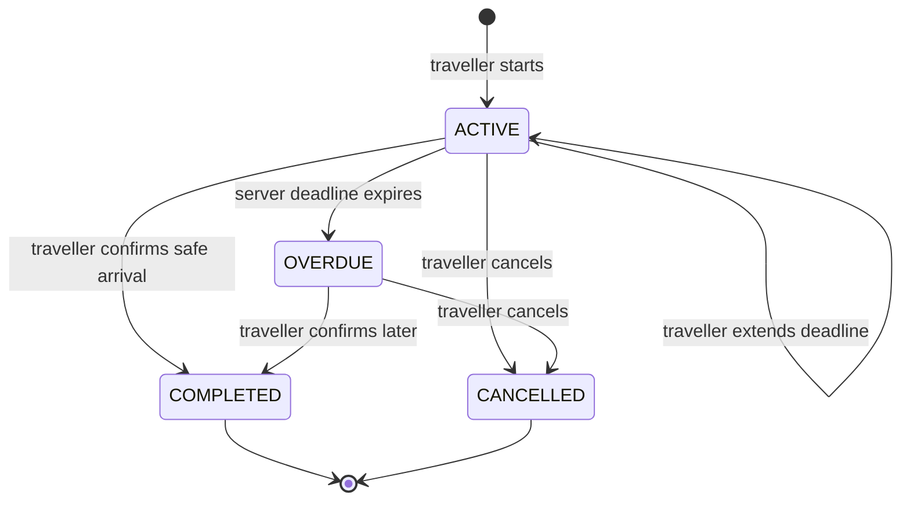
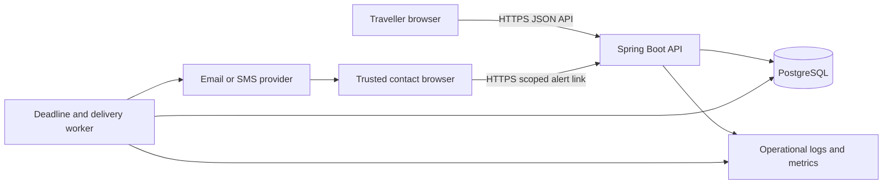
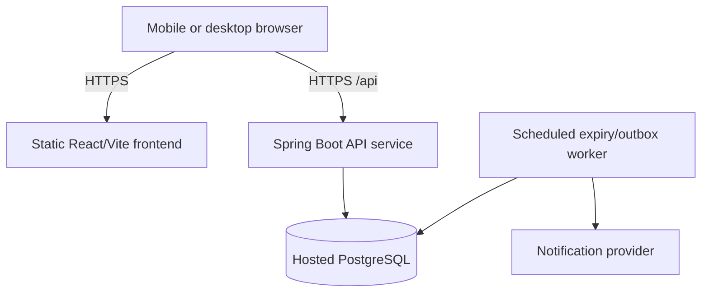
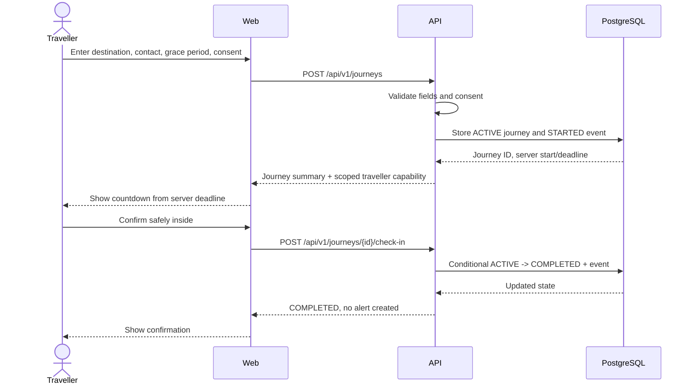

# SafeArrival system blueprint

**Status:** Proposed build plan; decisions that need user research or hosting verification are marked **Open**.  
**Purpose:** One implementation reference for the product scope, behavior, data model, API, security, deployment, and delivery sequence.  
**Last updated:** 8 November 2026

> This plan describes a check-in and communication aid. It is not an emergency response service, personal security guarantee, vehicle tracker, or proof that a missed check-in means someone is in danger. Interview findings in `04-research-synthesis.md` are still pending, so the proposed MVP is a testable hypothesis, not validated demand.

## 1. Product goal and boundary

SafeArrival lets a person set a journey arrival window and choose a trusted contact. The person confirms once safely inside. If the deadline passes without confirmation, the system records an overdue event and attempts the configured contact notification. The contact can acknowledge it. The wording stays neutral: a missed check-in is ambiguous.

### In scope for the first useful system

- Mobile-first web experience for the traveller and a simple contact alert/acknowledgement view.
- Start, view, extend, confirm, and cancel a journey.
- User-chosen arrival grace period and one trusted contact in the MVP; multiple contacts are a later extension.
- Server-owned deadline and durable overdue/notification-attempt records.
- Honest notification status; SMTP ambiguity is recorded without an automatic resend.
- Minimal journey information and optional last shared location only when the user explicitly shares it.
- Fictional seed/demo data and a clearly marked demo mode for walkthroughs.
- Accessibility, clear failure states, and an audit trail for journey state changes.

### Out of scope

- Police/ambulance dispatch, armed response, or a promise that anyone will respond.
- Continuous/background GPS tracking, geofence-based safety confirmation, or vehicle tracking/recovery.
- Caller identity tracing, public crime maps, neighborhood broadcasting, or suspect reporting.
- Automatic calling, loud alarms, or an alert to a contact without an explicit user-configured consent path.
- Native app, wearable, vehicle integration, or offline delivery guarantee.

## 2. Actors and terminology

| Actor / term | Meaning |
| --- | --- |
| Traveller | Starts and manages their own journey; explicitly confirms safe arrival. |
| Trusted contact | Person selected by the traveller to receive an overdue check-in notice and acknowledge it. |
| Journey | A single time-bounded check-in with a destination label, deadline, and state. |
| Arrival window | The traveller-selected period allowed for arrival and getting safely inside. |
| Overdue | The server deadline has passed without confirmation or cancellation. This is not an emergency verdict. |
| Notification attempt | A durable record that the system tried to deliver an overdue notice through a configured channel. |
| Demo mode | Fictional/local behavior with no external messages and a persistent “simulated” label. |

## 3. Product requirements and acceptance criteria

### P0 — MVP requirements

| ID | Requirement | Acceptance criteria |
| --- | --- | --- |
| P0-1 | Start a journey | Traveller can provide a destination label, choose an allowed arrival window, select one contact, review consent, and start. The server returns the stored start/deadline and journey reference. |
| P0-2 | Manage an active journey | Traveller can see remaining time/deadline, confirm safely inside, cancel, or extend the window. A journey has one active state transition at a time; repeated requests do not create duplicate events. |
| P0-3 | Expire overdue journeys | A backend worker finds due active journeys and atomically transitions each once to `OVERDUE`; browser closure does not stop the deadline. |
| P0-4 | Notify a contact | In live mode, the system queues one Gmail SMTP notice for an allowlisted recipient. Failed delivery is visible as failed/unknown, never as delivered; ambiguous sends are not retried. Demo mode never sends externally. |
| P0-5 | Contact response | A contact can open a protected notice, see that a check-in is overdue (not that danger is confirmed), and acknowledge that they saw it. Acknowledgement is recorded with time. |
| P0-6 | Honest status and safety copy | UI differentiates active, overdue, acknowledged, cancelled, completed, and failed delivery. It says the service does not dispatch responders or guarantee delivery. |
| P0-7 | Data minimisation | No location is collected by default. If location is explicitly enabled, store only the latest user-shared fix with captured time and accuracy, associated with an active journey. |
| P0-8 | Demo access | Evaluators can exercise the full flow using fictional data without entering a real phone number/address and can trigger overdue behavior via a demo control or short test deadline. Every simulated action is labelled. |

### P1 — only if time and research support it

- Multiple contacts with explicit order and per-contact channel preference; this requires one alert per contact and replaces the MVP's unique-alert-per-journey constraint with a unique `(journey_id, contact_id)` constraint.
- Contact response notes or a second escalation step, after false-alarm research.
- Persistent email/password accounts, session-based journey ownership, onboarding, and journey history are implemented. Account deletion and recovery flows remain outstanding.
- Optional, user-triggered location capture; do not add continuous tracking.
- Reminder to the traveller before the deadline only if it can be delivered without unsafe distraction.

### Screen and interaction inventory

| Screen | Primary content/actions | Required states |
| --- | --- | --- |
| Start / setup | Destination label, trusted contact, grace period, data-sharing notice, consent, start. | Empty, invalid input, contact unavailable, submitting, API unavailable, success. |
| Active journey | Server deadline, time remaining, destination label, selected contact, check-in, extend, cancel, last sync. | Active, stale/offline, extension pending/rejected, check-in pending/success, cancel confirmation. |
| Overdue traveller view | Neutral overdue status, overdue duration/detection time, contact notification status if known, complete/cancel. | Sending, provider accepted, failed, unknown, simulated. Never use “in danger” as a state. |
| Contact alert | Why they received notice, journey start/deadline, last shared location only if explicitly enabled, acknowledge. | Valid, acknowledged, revoked, expired/invalid link, network failure. Do not show full history or exact destination address by default. |
| Completion / cancellation | Confirmed/cancelled status and timestamp; offer start another journey. | Completed, cancelled before expiry, cancelled after overdue alert, API failure. |
| Demo controls (non-production only) | Reset fictional data, expedite deadline, switch between simulated outcomes. | Hidden/disabled outside explicit demo environment; persistent simulation banner. |

All forms need labels, keyboard-operable controls, visible focus, clear inline errors, and polite status announcements. Countdown changes should not be announced every second to assistive technology; announce meaningful state transitions only. Respect reduced-motion preferences.

### Operational qualities

- Mobile viewport first, usable at 320 px width and with keyboard/screen reader navigation.
- API timestamps stored in UTC; display localized times with timezone labels when ambiguity matters.
- All deadline comparisons use server time. Client countdown is informational only.
- Validate fields server-side; bound destination length, grace period, and request size.
- Every state transition is transactional and has a corresponding event record.
- API and worker failures must not silently lose an overdue event or report a successful alert.

## 4. Proposed end-to-end behavior

1. Traveller opens the web app and chooses a trusted contact and an arrival window.
2. Before starting, the interface explains what is shared, when a contact might be notified, how cancellation works, and what the service cannot do. The traveller confirms consent.
3. The API validates input and creates a `journey` with `ACTIVE` status, `deadline_at`, contact snapshot/reference, account owner when signed in, and an audit event. Account sessions authorize owned journeys; the scoped traveller capability remains available for an accountless demo.
4. The traveller sees a countdown derived from the server deadline. The countdown is not the authority; the backend is.
5. Traveller may extend the deadline or cancel before expiry. Each change is authenticated, validated, recorded, and returned with the new server deadline/state.
6. If the traveller explicitly presses “I’m safely inside” before expiry, the API changes state to `COMPLETED`; no alert is sent.
7. A scheduled worker claims due active journeys, changes each to `OVERDUE` exactly once, appends an event, and enqueues notification work in the same database transaction (transactional outbox).
8. The delivery worker sends a minimal Gmail SMTP notice in live mode. It updates attempt state to `SENT`, `FAILED`, or `UNKNOWN`. SMTP acceptance is not proof of inbox delivery; ambiguous sends are not retried automatically because SMTP has no idempotency key. Demo mode writes a simulated attempt only.
9. Contact opens a signed, scoped, expiring link and sees the overdue message, journey start/deadline, and any explicitly shared last location (with timestamp/accuracy). They may acknowledge receipt. The acknowledgement is not a confirmation of safety.
10. Traveller can still complete/cancel an overdue journey. That updates the contact view and, if configured, may send a resolution update. This behavior and copy are **Open** for interview validation.

### State model



`ACKNOWLEDGED` is a contact response state on an alert, not a journey state. Journey status and notification delivery status are separate so that a failed message does not revert an overdue journey.

## 5. System context and architecture

### Logical architecture



### Deployment shape



### Current stack and proposed responsibilities

| Component | Choice / responsibility |
| --- | --- |
| Workspace | Existing Nx + pnpm monorepo. |
| Web | Existing React + Vite + TypeScript app; screens, form validation, countdown display, API calls, status and errors. No authority over deadlines. |
| API | Java 21 / Spring Boot service; password authentication and sessions, validation, account/capability authorization, journey state transitions, contact views, worker scheduling, and notification delivery. |
| Database | PostgreSQL through Spring JDBC; Flyway migrations own schema. Never use production auto schema mutation. |
| Worker | Scheduled tasks in the API process. Conditional database updates make deadline transitions idempotent across overlapping worker runs. Hosting continuity still needs verification before deployment. |
| Notifications | Gmail SMTP email sender in live mode; simulated in demo mode. Email status means SMTP accepted, not inbox delivery. Ambiguous SMTP outcomes are marked `UNKNOWN` and are not automatically retried because SMTP provides no idempotency key. |
| Hosting | **Open:** verify a host for Java 21, persistent scheduling, outbound provider connectivity, HTTPS, secrets, free-tier limits/sleep, and database networking. |

Use same-origin `/api` routing where practical. If frontend and API are separately hosted, configure a narrow explicit CORS allowlist; do not allow arbitrary origins with credentials.

## 6. Data model / ERD

The proposed minimal production model supports a traveller, trusted contacts, journeys, state history, and notification delivery. If the internship demo remains entirely fictional and single-session, an accountless capability-token variant can simplify sign-in, but token handling is a security decision and should be locked before implementing APIs.

```mermaid
erDiagram
    TRAVELLER ||--o{ TRUSTED_CONTACT : manages
    TRAVELLER ||--o{ JOURNEY : starts
    TRUSTED_CONTACT o|--o{ JOURNEY : receives_alert_for
    JOURNEY ||--o{ JOURNEY_EVENT : records
    JOURNEY ||--o{ ALERT : creates
    ALERT ||--o{ NOTIFICATION_OUTBOX : queues
    NOTIFICATION_OUTBOX ||--o{ NOTIFICATION_ATTEMPT : records
    JOURNEY o|--o| SHARED_LOCATION : optionally_includes

    TRAVELLER {
        uuid id PK
        string email UNIQUE
        string auth_subject UNIQUE
        timestamp created_at
        timestamp deleted_at
    }
    TRUSTED_CONTACT {
        uuid id PK
        uuid traveller_id FK
        string display_name
        string channel
        string destination_ciphertext
        boolean consent_recorded
        timestamp created_at
        timestamp deleted_at
    }
    JOURNEY {
        uuid id PK
        uuid traveller_id FK
        uuid contact_id FK
        string destination_label
        string status
        timestamp started_at
        timestamp deadline_at
        timestamp completed_at
        timestamp cancelled_at
        timestamp created_at
        timestamp updated_at
        integer version
    }
    JOURNEY_EVENT {
        uuid id PK
        uuid journey_id FK
        string event_type
        string actor_type
        jsonb safe_metadata
        timestamp occurred_at
    }
    ALERT {
        uuid id PK
        uuid journey_id FK
        uuid contact_id FK
        string status
        string access_token_hash
        timestamp created_at
        timestamp acknowledged_at
        timestamp expires_at
    }
    NOTIFICATION_OUTBOX {
        uuid id PK
        uuid alert_id FK
        string status
        string idempotency_key UNIQUE
        integer attempt_count
        timestamp available_at
        timestamp lease_until
        timestamp created_at
        timestamp completed_at
    }
    NOTIFICATION_ATTEMPT {
        uuid id PK
        uuid outbox_id FK
        string channel
        string provider_message_id
        string outcome
        integer attempt_number
        timestamp attempted_at
        timestamp delivered_at
        string failure_code
    }
    SHARED_LOCATION {
        uuid id PK
        uuid journey_id FK UNIQUE
        decimal latitude
        decimal longitude
        integer accuracy_m
        timestamp captured_at
        timestamp deleted_at
    }
```

### Data model decisions and constraints

- Store only what the flow needs. Do not store route history, location trails, alleged incident details, or contact-book imports.
- `destination_label` is a short user-provided label (for example “Home”), not an address by default.
- Contact email is sensitive. Live-mode addresses and queued send payloads are encrypted at rest with AES-GCM under `DATA_ENCRYPTION_KEY`; never log them. Key rotation is not implemented.
- `access_token_hash` stores a hash of a high-entropy, one-time or expiring contact capability; raw link tokens are shown once and are never stored/logged. Scope it to one alert and contact view.
- `safe_metadata` must be an allowlisted small set of non-sensitive fields, not arbitrary request bodies.
- Use migrations (Flyway or Liquibase; choose one before API build). Include constraints and indexes on due journey lookup `(status, deadline_at)`, contact lookup, traveller history, and alert token hash.
- `version` enables optimistic concurrency or compare-and-set state transitions. A unique alert per journey prevents duplicate expiry alerts.
- Define retention before collecting live data. Proposed default: remove detailed completed/cancelled journey and location data after a short period; retain only de-identified operational counts if justified. Exact duration is **Open** and should be chosen with the supervisor/users before launch.
- For a pure demo, seed only obviously fictional records and provide a reset path. Never commit real participant contact information.

## 7. UML sequence diagrams

### Start a journey and complete safely



### Deadline expiry, delivery attempt, and contact acknowledgement

```mermaid
sequenceDiagram
    participant Worker
    participant DB as PostgreSQL
    participant Provider
    actor Contact
    participant Web
    Worker->>DB: Claim ACTIVE journeys where deadline_at <= now
    DB-->>Worker: Claimed rows (locked/leased)
    Worker->>DB: Set OVERDUE; create ALERT, event, outbox attempt
    Worker->>Provider: Send minimal notice with scoped link
    Provider-->>Worker: Accepted, rejected, or timeout
    Worker->>DB: Persist SENT/FAILED/UNKNOWN attempt status
    Provider-->>Contact: Notice, when delivered
    Contact->>Web: Open expiring alert link
    Web->>DB: Validate hashed token and expiry
    DB-->>Web: Overdue summary and delivery/ack state
    Contact->>Web: Acknowledge notice
    Web->>DB: Set acknowledged_at once + event
    Web-->>Contact: Acknowledgement recorded; no safety claim
```

### Cancellation or concurrent expiry

```mermaid
sequenceDiagram
    actor Traveller
    participant API
    participant DB as PostgreSQL
    participant Worker
    Traveller->>API: Cancel journey with current capability
    API->>DB: Conditional update if status is ACTIVE or OVERDUE
    alt Cancellation commits before expiry claim
        DB-->>API: CANCELLED
        API-->>Traveller: Cancellation confirmed
        Worker->>DB: Due query excludes CANCELLED
    else Expiry already committed
        DB-->>API: Current status OVERDUE
        API-->>Traveller: Cancel overdue journey; report existing alert status
        Note over API,DB: Do not erase an already attempted alert; record cancellation and send resolution only if configured
    end
```

## 8. API contract (proposed)

Hosted endpoints use HTTPS and JSON. Accounts use BCrypt password hashes, random session tokens stored only as SHA-256 hashes, and HttpOnly SameSite cookies. Accountless demo journeys continue to use random capability tokens stored only as hashes. Email verification, password recovery, and account deletion remain **Open** before public registration.

| Method and path | Purpose | Key rules |
| --- | --- | --- |
| `POST /api/v1/journeys` | Start journey | Validate consent, destination length, contact ownership, window range; return server timestamps and one-time capability if accountless. |
| `GET /api/v1/journeys/{id}` | Read own active/recent journey | Requires traveller auth/capability; return minimal fields. |
| `POST /api/v1/journeys/{id}/check-in` | Confirm safe arrival | Idempotent; only valid from `ACTIVE` or `OVERDUE`; capture server time. |
| `POST /api/v1/journeys/{id}/cancel` | Cancel | Idempotent; preserve already-created alert/attempt history. |
| `POST /api/v1/journeys/{id}/extend` | Extend deadline | Require bounded positive extension, current auth, and allowed journey state; record prior/new deadline. |
| `GET /api/v1/contact-alert` | Contact alert view | Require alert capability in `Authorization: Bearer`; token scoped, hashed at rest, expiring, rate-limited; no traveller account data. |
| `POST /api/v1/contact-alert/acknowledge` | Contact acknowledgement | Same scoped capability in header; idempotent; record time, no arbitrary notes in MVP. |
| `GET /actuator/health` | Liveness/readiness | Expose only required health details; do not leak environment/configuration. |

Example start request:

```json
{
  "destinationLabel": "Home",
  "trustedContactId": "uuid",
  "arrivalWindowMinutes": 15,
  "consent": {
    "contactMayBeNotifiedIfOverdue": true
  }
}
```

The server records consent version and acceptance time; the client cannot choose the timestamp. Use `Idempotency-Key` for journey creation and external delivery actions. Return standard `400` validation, `401/403` access, `404` unknown resource, `409` invalid state/concurrency, `429` rate limit, and generic `5xx` without sensitive internals. Include a correlation ID in logs and error responses.

### Suggested response shape

```json
{
  "id": "uuid",
  "status": "ACTIVE",
  "destinationLabel": "Home",
  "startedAt": "2026-11-08T18:30:00Z",
  "deadlineAt": "2026-11-08T18:45:00Z",
  "serverNow": "2026-11-08T18:30:00Z"
}
```

Do not return provider credentials, raw contact addresses, database IDs unrelated to the caller, raw capability secrets on subsequent GETs, or stack traces.

### Field rules and state constraints

| Field | Rule | Reason / failure response |
| --- | --- | --- |
| `destinationLabel` | Trim whitespace, 1–48 Unicode characters, reject control characters; plain text only. No address/geolocation requirement. | `400 INVALID_DESTINATION` |
| `trustedContactId` | Required; must belong to the authenticated traveller (or be an explicitly confirmed demo contact). | `400 INVALID_CONTACT` or `404` without revealing another traveller's contact. |
| `arrivalWindowMinutes` | Integer 5–90 inclusive, configurable; no fractional minutes. Proposed cap is a product default, confirm in interview. | `400 INVALID_WINDOW` |
| `consent.contactMayBeNotifiedIfOverdue` | Must be `true` to create a live-notification journey. Demo mode says simulation explicitly. | `400 CONSENT_REQUIRED` |
| extension | Integer 1–60 minutes; proposed cumulative maximum 120 minutes; only while `ACTIVE`; each extension resets deadline from current server time only if product decision chooses that behavior. | `400 INVALID_EXTENSION` or `409 JOURNEY_NOT_ACTIVE`. **Open:** from-now vs add-to-deadline. |
| check-in/cancel | No body required; derive actor and timestamp server-side. | Idempotent response if already in target/terminal state; otherwise `409`. |
| coordinates | Latitude −90…90, longitude −180…180, accuracy positive and bounded; require explicit consent and captured time no more than a short configured age. | Reject invalid/stale values; location is absent by default. |

These are proposed bounds for implementation and usability review, not facts derived from interviews.

### Enumerations and database invariants

Use explicit enums, not arbitrary strings:

- `journey.status`: `ACTIVE`, `OVERDUE`, `COMPLETED`, `CANCELLED`.
- `journey_event.event_type`: `STARTED`, `DEADLINE_EXTENDED`, `OVERDUE`, `CHECKED_IN`, `CANCELLED`, `CONTACT_ACKNOWLEDGED`, `LOCATION_SHARED`, `DATA_DELETED`.
- `journey_event.actor_type`: `TRAVELLER`, `CONTACT`, `SYSTEM`, `ADMIN` (admin actions should be rare and audited).
- `alert.status`: `PENDING`, `OPENED`, `ACKNOWLEDGED`, `REVOKED`, `EXPIRED`.
- `notification_outbox.status`: `QUEUED`, `SENDING`, `SENT`, `UNKNOWN`, `FAILED`, `CANCELLED`, `SIMULATED`.
- `notification_attempt.outcome`: `ACCEPTED`, `REJECTED`, `UNKNOWN`, `SIMULATED`.
- `trusted_contact.channel`: initially `EMAIL` or `SMS`; one channel may be disabled until selected.

Required constraints/indexes:

- `deadline_at > started_at`; `arrivalWindowMinutes` and extension limits also enforced in service validation.
- Foreign keys with restrictive deletion until retention workflow explicitly removes dependent records.
- Unique `alert.journey_id` for one overdue alert per journey in the single-contact MVP; unique outbox idempotency key and unique `(outbox_id, attempt_number)`.
- Unique `traveller.auth_subject`; unique active contact destination per traveller only if research/product needs that rule.
- Due-work index `(status, deadline_at)` and indexes on `(traveller_id, created_at DESC)`, `alert.access_token_hash`, `(notification_outbox.status, available_at)`, and `(outbox_id, attempt_number)`.
- Use `NUMERIC` or integer microdegrees for coordinates (never float equality); timestamps use timezone-aware `TIMESTAMPTZ`.
- Do not rely on application-only validation for status transition invariants. Perform conditional update or row-locked transaction.

### Core field semantics

| Table/field | Meaning and lifecycle |
| --- | --- |
| `traveller.auth_subject` | Stable external identity subject, nullable only for accountless demo journeys; never an email used as a mutable identity key. |
| `trusted_contact.destination_ciphertext` | Encrypted normalized email/phone used only for selected channel; plaintext exists only transiently for provider call. |
| `trusted_contact.consent_recorded` | Traveller attests they may nominate this person; does not prove recipient consent or delivery. For live use, consider contact confirmation before relying on destination. |
| `journey.deadline_at` | Authoritative UTC expiry instant. A deadline extension updates this field and writes old/new values in a narrowly allowlisted event. |
| `journey.version` | Monotonic optimistic-lock version for concurrent traveller/worker transitions. |
| `journey_event.safe_metadata` | Allowlisted transition metadata, such as prior/new deadline or delivery status category; never raw request body, coordinates, or contact destination. |
| `alert.access_token_hash` | Hash of capability whose scope is this one alert. Revoke/expire by clearing or marking it invalid; do not reuse tokens across alerts. |
| `notification_outbox.available_at` | Earliest eligible send time. Current implementation queues immediately and does not retry. |
| `notification_outbox.lease_until` | Recovery point for a worker that crashes while sending; an expired send becomes `UNKNOWN` and is not reclaimed. |
| `notification_attempt.provider_message_id` | Provider-side reference, when returned; treat as operational metadata and limit retention. |
| `shared_location.captured_at` / `accuracy_m` | Time and reported uncertainty for a user-triggered fix; never imply continuous/live location. |

Exact column nullability, ciphertext format/key rotation, and whether contact confirmation is mandatory are **Open** implementation decisions; settle them before writing migration V1.

### Example API error body

```json
{
  "type": "about:blank",
  "title": "Journey is no longer active",
  "status": 409,
  "code": "JOURNEY_NOT_ACTIVE",
  "correlationId": "opaque-request-id"
}
```

Never include sensitive values in validation details. A `401` means no valid authentication; a `404` is preferred over `403` when resource existence would leak another user's data.

### Authentication and capability lifecycle

**Current prototype:** the app supports email/password registration and sign-in, BCrypt password hashes, 30-day revocable server sessions in HttpOnly cookies, and account-owned journey history. The onboarding step stores a timezone and default arrival window. Email ownership verification, password recovery, account deletion, and trusted-contact verification are not implemented. Keep live recipient allowlisting in place.

The prototype also retains accountless, capability-based access for fictional demo journeys and scoped contact links. Traveller and contact capabilities are independently generated; raw values are returned only to the authorized browser/link flow and SHA-256 hashes are stored by the API. Demo journeys can be reset with the local database. Before public production use, replace or formally review the prototype password/session implementation, add account recovery and deletion, verify contact destinations, and add abuse controls.

For either mode:

1. Generate at least 32 bytes from a cryptographic random source; encode URL-safe without padding.
2. Persist a one-way keyed hash (HMAC with a separately managed key is preferable for lookup tokens); do not persist the raw token.
3. Compare hashes in constant time; impose rate limits; do not distinguish expired, revoked, or unknown contact tokens in public responses.
4. Contact token grants read-only access to one alert and permission to acknowledge it; it does not grant journey mutation or location history access. Put the token in a URL fragment (`/contact#token=...`) so browsers do not send it in HTTP requests or referrers; frontend extracts it once, removes the fragment with `history.replaceState`, keeps it in memory, and sends it only in the authorization header. No analytics or third-party script may run on this page.
5. Set link expiry and revocation rules; rotate/revoke when contact destination changes or journey is cancelled. **Open:** expiry duration, proposed 72 hours after overdue detection for a demo.
6. Never place tokens in analytics, referrer headers, logs, screenshots, or third-party assets. The contact page should load no third-party scripts. Configure proxy/API logging to omit authorization headers.

## 9. Security, privacy, and safety controls

### Consent and disclosure

- Explain before journey start which contact will be told, what triggers the notice, which fields are included, and that delivery/response is not guaranteed.
- Obtain separate explicit consent for optional location capture and sharing. No permission prompt before the user understands why it is requested.
- Contact details should be supplied/confirmed by the traveller with a clear statement that they have permission to share them. Confirm delivery destination before relying on it.
- Do not imply contact acknowledgement confirms that the traveller is safe.

### Access and application security

- Enforce ownership in every query and mutation, not only in frontend routing.
- Use established auth/session libraries if accounts are selected; secure, HttpOnly, SameSite cookies; CSRF defense for cookie-authenticated writes.
- For capability links, use at least 256 bits of cryptographic randomness, store only a keyed hash where possible, expire and revoke tokens, redact them from access logs/referrers, set `Referrer-Policy: no-referrer`, and rate-limit attempts.
- TLS everywhere; secrets only in deployment secret manager/environment, never source control or logs.
- Validate and encode all user-controlled text. Apply strict CORS, request limits, rate limiting, dependency updates, and security headers.
- Restrict actuator endpoints. Keep logs free of names, phone/email, exact location, full alert links, and request bodies.

### Location and retention

- Location is off by default and unnecessary for the core demo. Never infer “safe” from coordinates.
- If enabled: capture only on explicit action during an active journey; include captured timestamp and accuracy; avoid repeated sampling; share only under the disclosed alert policy; delete after journey retention expiry.
- Define retention/deletion and contact revocation flows before live data. Make account/journey deletion auditable and propagate deletion to backups according to provider capabilities.
- Use fictional data in development, screenshots, classroom/supervisor walkthroughs, and seed scripts.

### Reliability and failure behavior

- Outbox pattern prevents an expiry commit from being separated from its queued notice. Each outbox row represents one logical message; each send outcome is a separate attempt row.
- Locked/leased due-row claiming prevents concurrent workers from claiming the same queued message. SMTP's lack of an idempotency key means ambiguous sends are not retried.
- On provider timeout, status is `UNKNOWN` until reconciled; do not claim it failed or delivered without evidence.
- If the API is down at deadline, the next worker run processes overdue items; record actual detection time and original deadline.
- If no contact is configured or the provider is disabled, still record overdue state and clearly state no notice was sent.
- A browser timer is never used to trigger escalation; closed tab, sleeping device, lost network, and denied notifications must not alter server behavior.

### Notification delivery policy

The outbox row is the durable source of work; provider callbacks are supporting evidence, not the sole record. Keep the alert state separate from delivery state.

1. In the same transaction that changes a journey to `OVERDUE`, insert the `ALERT`, `JOURNEY_EVENT`, and one `NOTIFICATION_OUTBOX` row. Live mode encrypts the recipient/link payload; demo mode records a simulated attempt.
2. Worker claims a small batch using `FOR UPDATE SKIP LOCKED` (or an equivalent atomic lease), sets `SENDING` with a `lease_until`, and commits. Do not keep a database transaction open while making a network request.
3. Send a plain-text email with a scoped link. Do not include a home address or coordinates in the email.
4. A normal SMTP send return means the relay accepted the message, not that it reached an inbox or was read.
5. Persist the result as an immutable `NOTIFICATION_ATTEMPT`. `MailAuthenticationException` is recorded as `REJECTED`; other SMTP exceptions are `UNKNOWN` because delivery may have happened before the connection failed.
6. Do not automatically retry an `UNKNOWN` or abandoned `SENDING` attempt; Gmail SMTP has no idempotency key and a retry could duplicate a safety alert. Surface the uncertainty to the traveller.
7. If the traveller completes/cancels while an email is still queued, cancel that queued message. A message already accepted or in flight cannot be recalled; the scoped contact page shows the latest journey status.
8. Demo mode records `SIMULATED` and displays an in-app contact notice only. It must not call the mail sender.

Provider delivery receipts and whether resolution notices are sent remain **Open**. The prototype uses Gmail SMTP and does not automatically retry.

### Retention and deletion schedule (proposal)

Retention durations are product/legal decisions; these are conservative defaults for discussion and must be confirmed before any real contact/location data is used.

| Data | Proposed lifetime | Deletion behavior |
| --- | --- | --- |
| Active journey and associated contact reference | Until completion/cancellation plus 24 hours; overdue journey up to 7 days unless resolved | Delete or anonymise personal fields; revoke capabilities. |
| Completed/cancelled journey detail and state events | 7 days after terminal state in the prototype | Scheduled purge; retain only non-identifying aggregate counts if justified. |
| Shared location | Until journey terminal state plus 24 hours, maximum 7 days | Delete coordinates and location link; do not preserve in event JSON or logs. |
| Contact destination | While contact is saved; delete immediately on removal and on account deletion | Remove encrypted value and keys/wrapped key reference; acknowledge backup expiry limits. |
| Alert capability token hash | Until 72 hours after alert creation or acknowledgement plus 24 hours, whichever first | Revoke and delete hash; landing page then gives generic unavailable message. |
| Notification provider response metadata | 30 days, only delivery status/code and provider ID where needed | Drop provider body and destination; retain no message content. |
| Security/audit event | 30 days, pseudonymous actor/resource IDs and event category only | No contact destination, token, exact location, request body, or free text. |
| Backups | Provider retention target, proposed max 30 days | Document restore/delete implications; purge on backup expiration or use crypto-erasure where supported. |

Deletion should be idempotent and recorded as a minimal `DATA_DELETED` audit category without retaining the deleted content. A retention worker should batch and throttle deletes, emit counts only, and alert on repeated failure. **Open:** exact retention and backup windows; do not call these legally approved periods.

### Threat model and abuse cases

| Threat | Control | Residual limitation |
| --- | --- | --- |
| Guessing journey IDs / insecure direct object reference | Random IDs plus authorization in every service query; capability required for accountless mode. | Stolen valid capability remains usable until revoked/expired. |
| Stolen contact link | High entropy, scoped, hashed, expiring, revocable token; no third-party assets/referrer leakage; HTTPS. | Email/SMS forwarding or compromised recipient device is outside app control. |
| Duplicate or forged contact notification | Provider adapter secrets, webhook signature verification, idempotency, rate limiting. | Provider acceptance is not proof of human receipt. |
| Malicious traveller sends repeated alerts | Rate limits, maximum active journeys, contact verification/consent, abuse monitoring. | MVP limits need calibration without blocking legitimate use. |
| Exposed contact/location in logs | Field-level log allowlist, redaction, no request-body logging, synthetic demo records. | Hosted provider may retain operational metadata; review its terms/settings. |
| Timer manipulation/client clock drift | Server timestamp and database/UTC time determine expiry and transitions. | Worker outage delays notification; show detection time honestly. |
| False or nuisance alert | Clear consent, grace window, extend/cancel, neutral language, acknowledge and revoke flow. | False alarms cannot be eliminated; contact response remains human judgment. |
| Service outage mistaken for safety | UI says last API sync/status; no claim of monitoring while offline; retry and overdue recovery on server. | User may be unable to reach service during network loss. |

For the internship, do not run intrusive security testing against hosted services outside the project scope. Test only owned environments and fictional records.

## 10. Hosting and notification decision record

| Decision | Proposed direction | Evidence still needed |
| --- | --- | --- |
| Database | Hosted PostgreSQL compatible with the Spring service; Neon is an option in existing docs. | Check sleeping/connection limits, region, backups, TLS, free-tier policy, and restore path on decision date. |
| API host | Host able to run Java 21 continuously and connect securely to PostgreSQL. | Verify scheduler continuity, restart behavior, scale-to-zero behavior, outbound network, health checks, logs, and free-tier limits. |
| Frontend host | Static HTTPS hosting, ideally same-origin/rewrite to API. | Confirm rewrite and environment handling. |
| Notification | Start with one channel behind an interface. For a demo, simulated delivery is acceptable; live channel only after consent, provider setup, and end-to-end verification. | Compare email/SMS cost, South African delivery, sender registration, test mode, webhook authenticity, retries, privacy terms, and free quota. |
| Scheduling | Spring scheduled worker with DB locking for a single always-on instance; transactional outbox for delivery. | If host can sleep or run multiple instances, select an always-on worker or managed scheduler and test duplicate prevention. |

Do not commit to a vendor from marketing pages alone. Record provider choice, plan limits, region, setup date, and observed behavior here before live rollout. Keep providers replaceable behind interfaces.

### Environment configuration contract

Maintain separate local, staging/demo, and production-like environments. Names below are proposed; store values in the host secret manager and provide only safe examples in `.env.example`.

| Variable | Required | Purpose |
| --- | --- | --- |
| `DATABASE_URL` | yes for API | PostgreSQL JDBC URL with TLS settings. |
| `DATABASE_USERNAME`, `DATABASE_PASSWORD` | yes for API | Restricted application DB role; not owner/admin role. |
| `APP_BASE_URL` | yes | Canonical HTTPS frontend URL for generated alert links; reject unknown host headers. |
| `APP_MODE` | yes | `demo` or `live`; demo prevents all external delivery. |
| `MAIL_USERNAME`, `MAIL_APP_PASSWORD`, `EMAIL_FROM` | live only | Dedicated Gmail sender and App Password; never use the account's normal password. |
| `LIVE_EMAIL_RECIPIENTS` | live only | Comma-separated recipients permitted until trusted-contact verification and abuse controls are implemented. |
| `AUTH_COOKIE_SECURE` | hosted live | Set to `true` so account-session cookies are sent only over HTTPS. |
| `DATA_ENCRYPTION_KEY` | live only | Base64-encoded 32-byte key for encrypted recipient payloads and shared location. |
| `APP_BASE_URL` | yes | Canonical app URL; HTTPS required for hosted live mode. |
| `CORS_ALLOWED_ORIGINS` | if cross-origin | Exact HTTPS origins, comma-separated; no wildcard with credentials. |
| `PORT` | host-dependent | Bind port supplied by runtime. |

Startup must fail clearly when live mode lacks required secrets or notification settings; demo mode must start with delivery hard-disabled. Never print secret values or full connection URLs in startup logs.

### Deployment and operational runbooks

**First deploy**

1. Create a managed PostgreSQL database and least-privilege app role; require TLS; confirm backup and restore options.
2. Configure API secrets and `APP_MODE=demo` by default. Set production CORS and canonical URL explicitly.
3. Apply versioned DB migrations as a one-off release step; verify schema before API startup. Do not let application startup alter production schema.
4. Deploy API and frontend over HTTPS; configure health checks, same-origin `/api` routing or narrow CORS, and static asset caching.
5. Start worker only after database connectivity and migrations are healthy. Ensure only one logical scheduler or use safe DB claims across replicas.
6. Create fictional demo data; exercise start, overdue, contact view, acknowledgement, completion/cancellation, and reset.
7. Check logs/metrics for PII, test access from a separate evaluator browser, and document the URL/access/reset steps.

**Routine release**

- Tag a source revision; deploy API and static bundle from the same commit.
- Back up before destructive migrations. Prefer expand/contract schema changes compatible with old and new application versions.
- Run migration, health check, synthetic demo flow, then make release available to evaluators.
- Roll back app artifact if health/flow fails. For irreversible schema/data changes, restore from backup or run a reviewed forward fix; do not assume code rollback reverses a migration.

**Incident: notification delays/failures**

- Set live delivery off if duplicate/incorrect messages are suspected; preserve overdue records.
- Inspect aggregate queue age, attempt counts, and sanitized provider error categories. Do not export contact lists or message bodies.
- Confirm provider status, credentials and quota without exposing secrets. Recover queued work only after duplicate/idempotency behavior is understood.
- Record detection, impact window, action, and unresolved notices. If users were affected, use an approved contact channel to communicate; do not send unreviewed messages from the application.

**Incident: suspected credential or capability exposure**

- Revoke/rotate affected capability hashes or token signing/hash key; invalidate active links as required.
- Rotate provider and database credentials through the host secret manager; restart only the affected services.
- Review sanitized access records, remove exposed demo/live records, and notify supervisor/data owner according to the agreed incident process.
- Preserve only necessary evidence, with access restricted; document cause and corrective action.

**Database restore**

- Restore a backup to an isolated database first; validate schema and integrity before changing the production connection.
- Keep restored outbox rows paused during recovery; review queued and unknown notices before enabling the worker, since SMTP cannot provide idempotency reconciliation.
- After recovery, run health and synthetic flow checks, then record recovery point/time and any missing messages.

All runbooks assume a low-risk demo. A real product needs a named service owner, an incident contact, and a reviewed data-breach procedure before live users.

## 11. Verification and release checks

Verification is required before calling a hosted build usable. Cover these behaviors manually or in automation as time permits:

1. Start valid journey; reject invalid window/contact/consent; server deadline is authoritative.
2. Complete before deadline; no overdue alert/outbox item is created.
3. Expire journey with browser closed; exactly one alert and notification attempt are created.
4. Run worker twice / simulate retry; no duplicate alert or external delivery due to idempotency.
5. Cancel and extend; stale/concurrent state requests return coherent conflict or latest state.
6. Contact token works only for its alert, expires, cannot read other journeys, and acknowledgement is idempotent.
7. Provider failure, timeout, and disabled/demo mode are shown honestly.
8. No location permission means no coordinates collected; explicit location shows time/accuracy and is removed per retention.
9. Check mobile layout, keyboard use, labels, contrast, and screen-reader announcement for state changes.
10. Deploy to staging, run the complete flow using fictional data, inspect logs for sensitive-value leakage, then capture walkthrough evidence.

### Implementation map for this repository

Current package layout and planned extensions:

```text
apps/api/src/main/java/za/co/safearrival/
  journey/       controller, request/response DTOs, JDBC service, state rules
  contact/       contact ownership and confirmation
  alert/         scoped contact view and acknowledgement
  notification/  outbox worker, provider interface, demo adapter
  security/      traveller auth/capability and contact capability filters
  config/        CORS, clock, worker configuration
apps/api/src/main/resources/db/migration/
  V1__initial_schema.sql
  V2__notification_outbox.sql
apps/web/src/
  app/           route shell and page composition
  features/      journey setup, active journey, contact alert
  lib/           typed API client, auth capability handling
```

Keep controllers thin. Controllers parse/validate transport input; services enforce capability authorization and state transitions; JDBC operations perform conditional persistence; provider adapters own channel-specific formatting and callbacks. Inject a `Clock` so deadlines and verification use one consistent time source. Implement the expiry worker in small batches and expose only aggregate health metrics.

Flyway is configured as the schema migration tool. The initial migration creates the demo contacts, journeys, events, scoped contact alerts, notification outbox, and simulated attempt tables. The Compose reset command removes only the local demo volume and reseeds fictional contacts on API startup. Do not run a destructive reset against production-like data.

### Walkthrough script and evaluator checklist

Target duration: about 3–5 minutes. Use the hosted build and fictional names only.

1. **Set context (20 seconds):** Explain SafeArrival is a journey check-in prototype, not emergency dispatch, live tracking, or a safety guarantee. State whether the environment is simulated or sends verified real messages.
2. **Start (45 seconds):** Choose a fictional destination, demo contact, and grace period; point out the contact notice/consent explanation; start journey and show server-returned deadline/state (or explicitly identify the current demo-only client timer).
3. **Complete path (30 seconds):** Confirm safely inside; show completed state and that no overdue alert was generated.
4. **Overdue path (60 seconds):** Reset demo data; start another journey; use the documented demo-expiry control or short test deadline; show overdue wording and clearly labelled simulated notification.
5. **Contact path (45 seconds):** Open the scoped contact view, explain it is not proof of danger, acknowledge, and show acknowledgement state.
6. **Limits and design (45 seconds):** Show the ERD/architecture, mention no location by default, missed check-in ambiguity, provider/network limitations, and what remains open from interviews.
7. **Evaluator handoff:** Provide hosted URL, demo credentials or reset procedure, supported browsers, known limitations, and repository access; verify access from a clean browser before submission.

Before recording/submission, check that browser address bars, screen captures, console, and notifications contain no real contact details, capability token, coordinates, secret, or personal incident information. Remove/rotate demo capabilities after the walkthrough.

### Release checklist

- [ ] Research synthesis is complete, anonymous, and does not present desk research as participant evidence.
- [ ] Product decisions/open items are reconciled with the assignment rubric and documented.
- [ ] Deployed app and API revision are known; hosted links use HTTPS and work in a clean browser.
- [ ] Database migration has been applied; backups and reset behavior are understood.
- [ ] Demo mode cannot send any real external message; live mode only enabled after an end-to-end consented delivery check.
- [ ] Evaluator has full test access without requiring private personal data.
- [ ] Complete and overdue flows both work; worker/provider status is shown honestly.
- [ ] Security logs and browser artifacts do not expose identifiers, tokens, location, or secrets.
- [ ] Short walkthrough is rehearsed and recording uses fictional content.
- [ ] Source repository contains incremental commits and no credentials or real interview details.

## 12. Delivery sequence and checkpoints

### Phase 0 — Freeze decisions and research evidence

- Complete and anonymise the required three or more interviews; update `04-research-synthesis.md` with agreement, contradiction, and confidence.
- Confirm MVP user, real vs demo behavior, accountless vs account-based access, contact channel, and whether any location is needed.
- Confirm teacher/supervisor submission checklist, hosting constraints, and who can safely be contacted for a demo.

### Phase 1 — Design lock and data foundations

- Review this blueprint; resolve every **Open** decision or explicitly defer it.
- Create Flyway migrations, entity relationships, enums, constraints, indexes, seed data, and retention job outline.
- Define request/response DTOs, validation, auth/capability scheme, and threat model.

### Phase 2 — Core journey vertical slice

- Implement create/read/check-in/cancel/extend endpoints and mobile UI against the API.
- Implement server-owned countdown response and explicit state/error handling.
- Keep location and external notification disabled until their paths are configured and verified.

### Phase 3 — Deadline and contact workflow

- Implement due-journey worker, locking/lease, transition event, transactional outbox, Gmail SMTP sender, and honest status reporting. Do not retry ambiguous sends.
- Implement scoped contact link and acknowledgement.
- Verify cancellation/expiry race, duplicate worker, and provider outage behavior.

### Phase 4 — Host, rehearse, submit

- Deploy frontend, API, database, scheduler, secrets, TLS, and health checks.
- Use fictional test accounts/contacts; provide full evaluator access and reset steps.
- Rehearse short walkthrough: start journey → explain deadline → complete one journey → trigger overdue demo → show contact view/acknowledgement → explain limits.
- Capture hosted URL, access instructions, architecture/ERD, repository commits, and known limitations for submission.

### Critical path for the remaining few days

1. Finalize assignment requirements and research evidence immediately.
2. Lock whether the deliverable is a fully hosted simulated prototype or live contact notification; do not mix simulation and real dispatch claims.
3. Prioritize the end-to-end demonstrable check-in flow, server persistence, and resettable evaluator access.
4. Add a real notification provider only if credentials, consent, hosting continuity, and failure handling can all be verified before submission.
5. Keep location, continuous monitoring, and accounts out unless the evidence and time justify them.

## 13. Open decision register

| ID | Question | Recommended default until resolved | Owner / resolution evidence |
| --- | --- | --- | --- |
| D1 | Do interviews validate the gate/arrival grace-period problem? | Treat as a hypothesis; synthesize interview findings before claiming need. | Project team; anonymised interview synthesis. |
| D2 | Is evaluator demo-only sufficient, or are real alerts mandatory? | Full simulated contact flow, clearly labelled, until assignment rubric confirms live alerts required. | Check assignment brief and supervisor. |
| D3 | Account login or accountless capabilities? | Email/password accounts with scoped sessions for persistent history; accountless capability access remains available for demo/contact links. | Email verification, recovery and deletion workflows still need implementation before public launch. |
| D4 | Which channel/provider? | Gmail SMTP in live prototype mode, with an explicit environment allowlist; this is a bounded demo sender, not a production mail service. | Dedicated Gmail account, App Password availability, approved-recipient test, and inbox check. |
| D5 | What data retention period? | Keep only active journey data; delete detailed history quickly after completion, duration to be agreed. | User/supervisor and POPIA-informed review. |
| D6 | Should location ever be shared? | Off by default; a one-time encrypted share is implemented only after explicit user action. Remove or revise after interview evidence. | Interviews and explicit consent design. |
| D7 | What happens after contact acknowledgement or a late confirmation? | Acknowledge receipt only; do not infer safety. Confirm whether resolution notice should be sent. | Interview evidence. |
| D8 | Which host and database plan? | Choose only after verifying Java runtime, always-on scheduler, DB networking, free limits, backups, and health endpoints. | Current provider documentation and deployment rehearsal. |
| D9 | Can the worker run continuously? | Assume no until proven. Test host sleep/restart behavior; use managed scheduling or an always-on worker if necessary. | Deployment test. |

## 14. Current repository alignment

The repository contains an Nx/pnpm React/Vite frontend and a Spring Boot 3 / Java 21 API. The current implementation uses PostgreSQL with Flyway and JDBC (rather than JPA entities), random traveller/contact bearer capabilities stored as SHA-256 hashes, a server-owned journey deadline, scheduled overdue processing, an in-app simulated outbox record, and a contact acknowledgement view. The Vite dev server proxies `/api` to the local API. `compose.yaml` provides a local PostgreSQL service with demo-only credentials.

Demo mode returns both scoped capabilities at journey creation so one browser session can preview the traveller/contact roles. Live mode creates the contact capability only after overdue status and sends its link to an allowlisted email recipient. Gmail credentials, recipient allowlist, encryption key, and app URL are environment configuration; live mode refuses to start without them. A transactional outbox records send state. Since Gmail SMTP has no send idempotency key, an ambiguous or interrupted send is recorded as `UNKNOWN` and is never automatically retried.

The traveller can explicitly capture and share one current location fix. Coordinates are encrypted with AES-GCM using `DATA_ENCRYPTION_KEY`, omitted from email content, and exposed only through a scoped contact capability. The traveller can remove the fix; after journey completion/cancellation it is retained for at most 24 hours, and unresolved overdue records are purged after seven days. Contact capabilities expire 72 hours after alert creation. These are prototype defaults, not a reviewed production retention policy. The public emergency actions are manual `tel:` links to SAPS 10111 and mobile 112. No dispatch or response-partner integration exists.

Account registration/sign-in, onboarding preferences, revocable sessions, and owner-scoped journey history are implemented. The frontend uses shadcn-style Button, Card, Label, and Input primitives with a shared responsive design system. Email verification, password recovery, account deletion, trusted-contact verification, provider delivery receipts, a key rotation workflow, production hosting, and an authorized emergency response partner are not implemented. The project remains a hypothesis until at least three affected-person interviews are synthesised. Keep the live email recipient allowlist until trusted-contact verification, abuse controls, and a privacy review exist.

Update `docs/05-product-and-technical-design.md` only after interviews and this blueprint's open decisions are resolved; retain it as the short research-led decision summary and use this document as the implementation specification.
